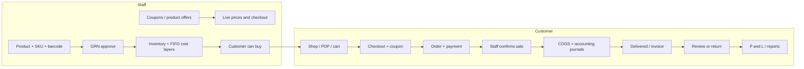
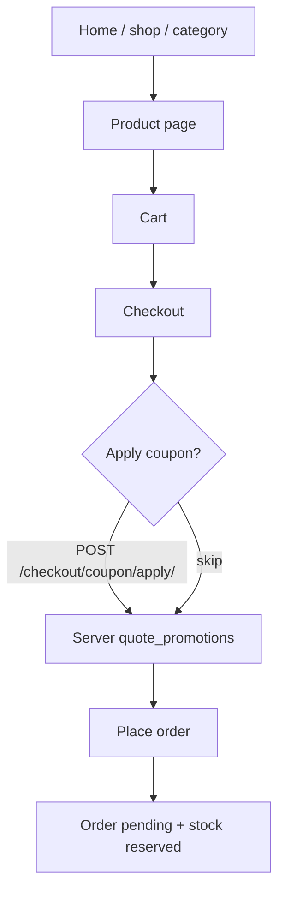

# FP Mart — E-commerce Management System

Django storefront plus staff panel for catalog, barcodes, inventory costing, purchasing, orders, payments, promotions, returns, reviews, and accounting.

Stack:

- Backend: Django 5.2
- Database: PostgreSQL
- Frontend: Django templates + Tailwind CSS (CDN, no Node.js)
- Auth: Django authentication (customers and staff are separate login flows)

Live example: `https://ecommerce-ms-lz72.onrender.com/`

---

## Project layout

```
ecommerce-ms/
├── manage.py
├── config/                 # settings, URLs, email, media, shared helpers
├── apps/
│   ├── accounts/           # staff login + per-user module permissions
│   ├── customers/          # register, profile, addresses, password reset
│   ├── categories/
│   ├── products/           # staff catalog, barcodes, public shop
│   ├── vendors/
│   ├── inventory/          # stock engine, FIFO cost layers, transactions
│   ├── purchases/          # GRN (goods received notes)
│   ├── orders/             # cart, checkout, order workflow, invoices
│   ├── payments/           # methods, proofs, paid/failed
│   ├── returns/
│   ├── promotions/         # coupons + product offers
│   ├── reviews/            # product reviews + customer feedback
│   ├── dashboard/
│   └── accounting/         # chart of accounts, ledger, P&L, reports
├── templates/              # store, staff, emails, print invoice
├── static/                 # CSS, JS, brand logos
├── media/products/         # catalog photos shipped with the deploy
├── scripts/gmail_bridge.gs # HTTPS mail sender for Render
├── requirements.txt
└── .env.example
```

---

## Run locally

1. Install Python 3.12+ and PostgreSQL.

2. Create a virtual environment and install dependencies:

```powershell
cd C:\Users\my147\Desktop\ecommerce-ms
python -m venv .venv
.\.venv\Scripts\Activate.ps1
pip install -r requirements.txt
```

3. Copy environment settings:

```powershell
copy .env.example .env
```

4. Start PostgreSQL, create database `ecommerce_ms`, and match the `DB_*` values in `.env`. On Render, use `DATABASE_URL` instead.

5. Migrate, seed, and run:

```powershell
python manage.py migrate
python manage.py seed_system
python manage.py createsuperuser
python manage.py seed_demo
python manage.py runserver
```

6. Open:

| Surface | URL |
| --- | --- |
| Storefront | http://127.0.0.1:8000/ |
| Customer login | http://127.0.0.1:8000/account/login/ |
| Staff panel | http://127.0.0.1:8000/staff/accounts/login/ |
| Django admin (emergency) | http://127.0.0.1:8000/django-admin/ |

Demo accounts from `seed_demo`:

- Staff: `manager` / `manager123` (all modules)
- Customer: `customer` / `customer123`

Other staff users only see modules assigned under **Users & Permissions**. Superusers see every module.

---

## Whole website flow

There are two sides of the same system:

1. **Customer storefront** — browse, cart, checkout, track orders.
2. **Staff panel** — catalog, stock, promotions, fulfil orders, payments, returns.

They share one PostgreSQL database. Staff never uses the customer password-reset email flow; customers never see staff URLs.



### 1. Staff prepares the catalog (must happen first)

Typical first-time path:

1. **Users & Permissions** — create staff and tick modules (Dashboard, Products, GRN, Orders, Promotions, Accounting, …).
2. **Categories** — add top-level categories (and optional children).
3. **Vendors** — add suppliers.
4. **Products** — name, selling/purchase price, optional catalog `%` markdown, main photo + gallery.
   - SKU is auto (`SKU-…`).
   - A unique **Code 128 barcode** (`FP` + digits) is generated on save and does not change when you edit price or stock.
   - For a multi-size garment, create one style listing, leave its **Size** blank, then add each size/color under **Size and color variants**. Each option receives its own SKU and barcode; receive/adjust stock against that option, not the style listing.
5. **GRN** — create a goods-received note with lines (dropdown or barcode scan), then **Approve**.
   - Approval posts stock through `record_stock_transaction`.
   - A FIFO **cost layer** stores the actual GRN purchase rate (not the current product purchase price).
   - Accounting posts Inventory Dr / Accounts Payable Cr. Pending GRN does not add sellable stock.
6. **Inventory** — warehouse on-hand vs reserved, barcode search, low stock, min stock level, manual adjustments.
7. **Payments → Methods** — enable COD / bank / wallet methods customers will see at checkout.
8. **Promotions**
   - **Coupons** — code customers type at checkout (`SAVE10`).
   - **Product offers** — timed sale on selected products (badge + sale price on the shop).
9. **Accounting** `/staff/accounting/` — dashboard, sales, purchases, expenses, cash/bank, ledger, P&L, reconciliation.
   - Journals are created from real events (GRN approve, order confirm, payment paid, return, expense). Staff do not type each sale by hand.

Until GRN is approved, the shop can show products as out of stock.

### 2. Customer browses and buys

Customers open the single style page, select an available size/color, choose quantity, and add that option to the cart. Each variant is stocked and reserved independently; its size/color is saved on the order and invoice. If a style’s existing stock has no size recorded, assign that stock a size before adding variants.



Step by step:

1. **Home** `/` — categories, live coupon codes (if “Show on website”), featured products.
2. **Shop** `/shop/` — search, category, price sort.
3. **Category** `/category/<slug>/`.
4. **Product** `/product/<slug>/` — gallery, sale badge, stock, WhatsApp enquiry, add to cart.
5. **Cart** `/cart/`
   - Guests: session cart.
   - Logged-in customers: `CartItem` rows in the database (session cart merges on login).
   - Quantity cannot exceed available stock (on-hand minus reserved).
6. **Checkout** `/checkout/` (customer login required)
   - Needs at least one **address**.
   - Choose billing/shipping, payment method, optional payment screenshot (not for COD).
   - Enter coupon → **Apply**. The browser never sends a discount amount; the server recalculates.
   - Summary shows: subtotal, product offer (if any), coupon (if any), shipping, total.
7. **Place order**
   - Stock is **reserved**.
   - Coupon usage is recorded only after the order is created (not when Apply is clicked).
   - Cart and applied coupon session are cleared.
   - Customer lands on `/orders/<id>/`.

Guest checkout is not supported: the customer must register or log in before `/checkout/`.

### 3. Payment

At checkout the customer picks an active **payment method**:

- **COD** — no screenshot. Staff (or auto-on-delivery) marks it collected.
- **Online / bank / wallet** — customer uploads a screenshot. Staff opens **Payments** or the order page and **Approve screenshot** / **Reject**.

Order payment status and payment record stay in sync. Gateway credentials belong in env vars; views do not talk to a provider API directly.

### 4. Staff fulfils the order

Staff **Orders** `/staff/orders/<id>/`:

```
Pending → Confirmed → Processing → Delivered
```

- **Pending** — stock is **reserved only**. This is not a completed sale. Customer may cancel; reservation is released; coupon usage is restored. No revenue/COGS journal.
- **Confirmed** — final sale event: reserved stock converts to sold, FIFO cost layers are consumed, revenue + COGS journals post (once). Customer cannot cancel in-app (contact email / WhatsApp).
- **Processing** — warehouse prep. No second sale posting.
- **Delivered** — thermal invoice number is issued; customer can print `/orders/<id>/invoice/`. COD can be marked paid automatically (cash journal on **paid**, not on screenshot upload).
- Customer may optionally tap **I received this order** (`received`).

Each status change writes `OrderStatusHistory` and the on-page tracker.

### 5. After delivery — reviews and returns

- **Review** — from the order, per line, after delivered/received. Staff moderate under **Reviews**.
- **Return** — customer requests from a delivered/received order (`/returns/order/<id>/new/`). Staff process under **Returns**. Approved restock goes through inventory transactions.
- **Feedback** — general store feedback at `/reviews/feedback/` (separate from product reviews).

### 6. Promotions in detail

Staff **Promotions** has two tabs.

**Coupons** (checkout codes)

- Offer name, unique code, % or fixed amount, min order, max discount, usage limit, per-customer limit, dates, active, show on website, applicable products.
- Empty product list = whole cart. Ticked products = those lines only.
- Home page only lists coupons with **Show on website** that are currently live.

**Product offers** (automatic sale price)

- % off, fixed rupee off, or Buy X Get Y on selected products.
- While live, product cards/PDP show original price, sale price, and a Sale badge.
- After end date the offer stops (status **Expired**); no cron job required.

**One calculator:** `apps/promotions/services.py` → `quote_promotions()`.

1. Unit price = lowest of list price, catalog `%` markdown, live product offer.
2. Buy X Get Y frees extra units on that line.
3. Coupon is validated (active, dates, min order, limits, eligible products).
4. Default `ALLOW_COUPON_WITH_PRODUCT_OFFER=false` — a coupon cannot also discount a line that already has a product offer.
5. Grand total is never below zero.

Set `ALLOW_COUPON_WITH_PRODUCT_OFFER=true` in `.env` only if stacking is intended.

### 7. Inventory movement (always via transactions)

| Event | Stock effect | Cost / accounting |
| --- | --- | --- |
| Approve GRN | On-hand up | FIFO layer at **actual GRN rate**; Inventory Dr, AP Cr |
| Place order | Reserve quantity | No sale, no COGS |
| Confirm | Reserved → sold | Consume FIFO layers; revenue + COGS |
| Cancel while pending | Release reservation; restore coupon | No sale journals |
| Cancel after confirm | Restock | Restore layers; reverse sale journals |
| Return (resellable) | On-hand up | Restore layers; reverse net sales + COGS |
| Return (damaged) | Not restocked for sale | Revenue reverse only; COGS stays |
| Payment marked paid | — | Cash/Bank Dr, AR Cr (screenshot upload is not money) |
| Expense / other income | — | Posted to P&L and cash/bank |

Nobody should edit `current_stock` by hand except **Inventory → Adjust**, which still writes a `StockTransaction`. Adjustments that add stock create a cost layer at the **current** product purchase price (reference cost for non-GRN stock).

**FIFO example (one warehouse):** GRN 100 × Rs.1,000 then 50 × Rs.1,200. Sell 120 → COGS = 100,000 + 24,000 = **124,000**. Remaining 30 × 1,200 = **36,000**. Changing `Product.purchase_price` later does not rewrite those layers.

Stock and costing stay **warehouse-specific**. An order stores `fulfillment_warehouse` (default warehouse today).

### 8. Product barcodes

Every product has a unique machine barcode, separate from SKU.

- Generated automatically on product create (`FP` + 10 digits, Code 128).
- Stored on the product. The PNG is generated from that value (so identity survives Render’s ephemeral disk).
- Does **not** change when selling price, purchase price, discount, or stock changes.
- Staff can print/download labels (`/staff/products/<id>/barcode/`) and regenerate only with confirmation.
- GRN and inventory accept a scan/type field that looks up `get_product_by_barcode()`. Prices always come from the server after lookup, never from the scanner string.

### 9. Accounting

Staff module **Accounting** (`/staff/accounting/`). Superusers see it; other staff need the Accounting permission (403 otherwise — hiding the sidebar is not enough).

Dashboard date filters: Today, Yesterday, This Week, This Month, Previous Month, custom range.

Figures come from posted journals + remaining cost layers:

- Today’s / period sales, COGS, gross profit, expenses, net profit
- Receivables, payables, cash, bank, inventory value
- Reports: P&L, sales, COGS, purchases, expenses, inventory valuation, cash, bank, ledger, customer/vendor statements, returns, tax summary
- Reconciliation lists mismatches (missing sale journal, GRN without cost layer, unbalanced journal, missing barcode, …) and does **not** silently invent or delete posted money

**Do not** backfill fake journals for old production orders. New GRNs, confirmed orders, paid payments, returns, and expenses post going forward.

### 10. Customer account

| Page | URL |
| --- | --- |
| Register / login / logout | `/account/register/` `/account/login/` `/account/logout/` |
| Forgot password | `/account/password-reset/` — email from `officermdm@gmail.com` |
| Dashboard | `/account/dashboard/` |
| Profile / addresses | `/account/profile/` `/account/addresses/` |
| Orders | `/orders/` |
| Returns | `/returns/` |
| Feedback history | `/reviews/feedback/history/` |

On Render, Gmail SMTP is blocked. Deploy `scripts/gmail_bridge.gs` as a Google Apps Script web app and set `EMAIL_HTTP_URL` + `EMAIL_HTTP_SECRET`.

---

## Staff panel map

Base: `/staff/` after `/staff/accounts/login/`.

| Module | URL prefix | What staff do |
| --- | --- | --- |
| Dashboard | `/staff/` | Sales snapshot |
| Users & Permissions | `/staff/accounts/users/` | Create staff, assign modules |
| Customers | `/staff/customers/` | View customer accounts |
| Categories | `/staff/categories/` | Tree of shop categories |
| Products | `/staff/products/` | Catalog, photos, barcode print |
| Vendors | `/staff/vendors/` | Suppliers |
| GRN | `/staff/grn/` | Receive stock, barcode scan, approve |
| Inventory | `/staff/inventory/` | Stock, barcode search, low stock, adjust, min level |
| Orders | `/staff/orders/` | Status, payment, print invoice |
| Payments | `/staff/payments/` | Proofs, mark paid/failed, methods |
| Returns | `/staff/returns/` | Approve/process returns |
| Reviews | `/staff/reviews/` | Moderate reviews + reply to feedback |
| Promotions | `/staff/promotions/` | Coupons and product offers |
| Accounting | `/staff/accounting/` | Dashboard, ledger, P&L, expenses, cash, reconciliation |

`/staff/accounts/` is **Users & Permissions**, not the accounting module. Accounting lives at `/staff/accounting/`.

Each page is gated by `ModulePermissionMixin`. A staff user without the Orders module gets 403 on `/staff/orders/`.

---

## Fields (forms and stored data)

What people type on screen vs what the database keeps. Auto-generated values are marked **auto**.

### Customer

**Register** `/account/register/`

| Field | Notes |
| --- | --- |
| First name, last name | Required |
| Email | Unique |
| Phone | Saved on `User.phone` |
| Username | Login name |
| Password, confirm password | Django password validators |

**Login** — username + password. **Forgot password** — email only; the email link sets a new password.

**Profile** `/account/profile/` — phone, profile image, date of birth.

**Address** `/account/addresses/add/`

| Field | Required |
| --- | --- |
| Full name, phone, address, city | Yes |
| Area, postal code | No |
| Default address | Checkbox; only one default per customer |

### Checkout and cart

**Cart line** — product, quantity (cannot exceed available stock).

**Checkout** `/checkout/`

| Field | Notes |
| --- | --- |
| Billing address | From saved addresses |
| Same as shipping | Checkbox |
| Shipping address | Used when “same as billing” is off |
| Payment method | Active methods only (COD, bank, Easypaisa, JazzCash, online) |
| Payment screenshot | Required unless COD |
| Coupon code | Separate **Apply** / **Remove**; the browser cannot submit a fake discount amount |
| Notes | Optional |

**Order (stored)** — order number **auto** (`ORD…`); snapshots of billing/shipping name, phone, address, city, area, postal code; payment method code; payment status; order status; subtotal; catalog discount; product-offer discount; coupon discount; shipping; tax; grand total; COGS total; fulfillment warehouse; coupon code; notes; invoice number **auto** on deliver (`INV…`).

**Order line (stored)** — product (nullable), SKU snapshot, product name snapshot, quantity, list unit price, catalog discount, offer discount, coupon discount, tax, line total, coupon percent, FIFO COGS amount.

### Staff — users

| Field | Notes |
| --- | --- |
| Username, first name, last name, email, phone | |
| Password, confirm password | Required on create |
| Active | Can log in |
| Profile image | Optional |
| Allowed modules | Checkboxes: dashboard, users, products, categories, vendors, GRN, inventory, customers, orders, returns, reviews, promotions, payments, **accounting** |

### Categories

| Field | Notes |
| --- | --- |
| Name | Slug **auto** from name if left empty |
| Slug | Unique URL piece |
| Description, image | Optional |
| Parent | Blank = top-level category |
| Active | Hidden from shop if off |

### Vendors

Name, company name, contact person, phone, email, address. Phone is required.

### Products

Staff form `/staff/products/add/`:

| Field | Notes |
| --- | --- |
| Name | |
| Selling price, purchase price | Decimals, PKR |
| Category, vendor, brand | Vendor/brand optional |
| Size, color, unit | Unit defaults to `pcs` |
| Discount % | Catalog markdown (not a timed offer) |
| Minimum stock level | Low-stock warning |
| Description | |
| Main image + gallery | Extra files; SKU is not typed |

**Auto:** SKU (`SKU-…`), slug, **barcode** (`FP` + 10 digits, unique). An inventory row is created with the product. On-hand quantity comes from GRN, not this form.

`Product.purchase_price` is the **current default / reference** buy price. It is updated when a GRN is approved, but it is **not** historical COGS. Historical cost lives on inventory cost layers.

**Barcode (product detail / print):** product name, SKU, barcode value, barcode image, selling price. Actions: Print, Download, Regenerate (confirm). Print page supports a copy quantity (same barcode on every label).

### GRN (goods received)

**Header:** vendor, supplier invoice number, warehouse. Optional **scan barcode** field (USB scanner = keyboard); product dropdown stays.

**Each line:** product, quantity, purchase rate, batch number, expiry date.

**Auto:** GRN number (`GRN…`), line total, status (pending until **Approve**), received by, approved by/at.

On **Approve:** stock up, FIFO cost layer (product, warehouse, GRN line, actual purchase rate, qty remaining, batch, expiry), AP journal. Approving twice is blocked.

### Inventory

**On-hand row (stored):** product, SKU, barcode, warehouse, current, reserved, available, incoming, sold, returned, damaged. Available = current − reserved. Search includes barcode.

**Cost layer (stored):** product, warehouse, GRN/line, purchase rate, received qty, remaining qty, batch, expiry, received at.

**Adjust form:** product, warehouse, signed quantity (+ add / − remove), type (adjustment / damage / correction), optional min stock level, notes.

**Transaction (stored):** product, warehouse, signed qty, type (GRN, sale, reserve, release, return, damage, correction, …), reference, user, notes.

### Promotions — coupons

`/staff/promotions/add/`

| Field | Notes |
| --- | --- |
| Offer name | Shown on home if “Show on website” |
| Coupon code | Unique, e.g. `SAVE10` |
| Discount type | Percentage or fixed amount |
| Discount value | `10` = 10% or Rs. 10 |
| Minimum order amount | After product offers |
| Maximum discount | Optional cap, mainly for % |
| Usage limit | Blank = unlimited total |
| Usage limit per customer | Default 1; blank = unlimited |
| Applicable products | Tick from inventory; none ticked = whole cart |
| Starts / ends | Date and time |
| Active | Can be redeemed |
| Show on website | Home coupon strip |

**Auto:** `used_count`. Apply-to (specific products vs all) follows the tick list.

### Promotions — product offers

`/staff/promotions/offers/add/`

| Field | Notes |
| --- | --- |
| Offer name | |
| Offer type | % / fixed Rs / Buy X Get Y |
| Discount value | For % and fixed |
| Buy quantity, get quantity | Buy X Get Y only |
| Applicable products | At least one |
| Starts / ends | |
| Active, show on website | |

Timed sale price is computed; it is not stored on the product row.

### Payments

**Method:** code (COD, online, bank_transfer, easypaisa, jazzcash), name, description, instructions, active, sort order.

**Payment record:** order, method, amount, status, transaction id, proof image, paid at.

Staff can set status + transaction id, or **Approve screenshot** / **Reject**.

### Returns

**Customer:** reason, description; per line: selected, quantity; optional photos.

**Staff:** status, staff notes; per line condition (resellable / damaged / missing).

**Auto:** return number (`RET…`).

### Accounting

`/staff/accounting/` — permission required.

**Expense** `/staff/accounting/expenses/add/` — title, category (rent, salaries, electricity, internet, marketing, delivery, packaging, maintenance, office, other), amount, date, payment account (cash / bank / wallet), reference, description, receipt, notes. Posts Dr expense / Cr cash-bank.

**Other income** — title, amount, date, account, reference, description, attachment, notes. Posts Dr cash-bank / Cr other income.

**Vendor payment** (payables page) — vendor, amount, date, payment account, reference, notes. Posts Dr AP / Cr cash-bank.

**Journal (stored)** — number **auto** (`JE…`), datetime, reference type/id, description, balanced debit/credit lines, actor. Posted rows are not deleted; corrections use reversal.

P&L: Gross sales − product discounts − offer discounts − coupon discounts − sales returns = net sales; − COGS = gross profit; + other income − operating expenses = net profit. COGS is FIFO consumption, never `purchase_price × qty`.

### Reviews and feedback

**Product review:** rating 1–5, comment. Staff approve/reject. One review per customer per product per order.

**Feedback:** topic (product / order / delivery / payment / website / other), rating, subject, message. Staff reply is stored with status.

---

## Public URL map

| URL | Purpose |
| --- | --- |
| `/` | Home |
| `/shop/` | Catalog |
| `/category/<slug>/` | Category listing |
| `/product/<slug>/` | Product detail |
| `/cart/` | Cart |
| `/checkout/` | Checkout |
| `/checkout/coupon/apply/` | Apply coupon (POST) |
| `/checkout/coupon/remove/` | Remove coupon (POST) |
| `/orders/` | Customer order list |
| `/staff/accounting/` | Accounting (staff, permission required) |
| `/staff/products/<id>/barcode/` | Print barcode labels |
| `/healthz/` | Render health check |
| `/media/...` | Product images public; payment/return files login-gated |

---

## Important rules in the code

- Money uses `DecimalField`, never floats.
- Discounts are calculated only on the server (`quote_promotions`). Changing HTML in DevTools cannot change the payable total.
- Stock changes go through `apps.inventory.services.record_stock_transaction`.
- Historical COGS uses FIFO cost layers from approved GRN rates, never current `Product.purchase_price × qty`.
- Product barcode is unique, product-level, and stable on edit. Lookup is `get_product_by_barcode()`.
- Sale accounting posts once on **confirm**. Payment cash posts only when status is **paid**. Screenshot upload is not money.
- Posted journals are not deleted; use reversal. Old production rows are not backfilled with fake money.
- Order lines store `product_name`, `sku`, size/color, `unit_price`, discount splits, and FIFO `cogs_amount` snapshots.
- Staff access is per user (allowed modules), not Django groups. Accounting URLs return 403 without the Accounting module.
- Customers can only open their own orders, returns, and addresses.
- Product main and gallery image fields use Cloudinary when its credentials are configured; local `media/products/` files remain a fallback. Set `CLOUDINARY_CLOUD_NAME`, `CLOUDINARY_API_KEY`, and `CLOUDINARY_API_SECRET` on Render (or set `CLOUDINARY_URL`). Existing database image paths must refer to uploaded Cloudinary assets or matching local files. Barcode identity is the database value; the PNG is regenerated from it.

---

## Environment

See `.env.example`. Common keys:

| Variable | Role |
| --- | --- |
| `SECRET_KEY`, `DEBUG`, `ALLOWED_HOSTS`, `CSRF_TRUSTED_ORIGINS` | Security |
| `DATABASE_URL` or `DB_*` | PostgreSQL |
| `CLOUDINARY_CLOUD_NAME`, `CLOUDINARY_API_KEY`, `CLOUDINARY_API_SECRET` or `CLOUDINARY_URL` | Product image storage |
| `EMAIL_HOST_*`, `EMAIL_HTTP_URL`, `EMAIL_HTTP_SECRET` | Password-reset mail |
| `WHATSAPP_NUMBER` | Product-page chat link (digits only, e.g. `923001234567`) |
| `SHIPPING_FLAT_RATE`, `TAX_PERCENT`, `CURRENCY` | Checkout totals |
| `ALLOW_COUPON_WITH_PRODUCT_OFFER` | Coupon + product-offer stacking (`false` by default) |

---

## Tests

```powershell
python manage.py test
```

Covered behaviour includes permission denial, GRN stock posting, FIFO cost layers, barcode uniqueness/lookup, negative-stock protection, customer order isolation, verified reviews, coupon limits, product-offer pricing, coupon/offer stacking, sale/COGS/payment posting, expenses, and accounting 403s.

---

## Production (Render)

- `DEBUG=False`, a long `SECRET_KEY`, real `ALLOWED_HOSTS`.
- `CSRF_TRUSTED_ORIGINS` includes the HTTPS service URL.
- Build: `pip install -r requirements.txt && python manage.py collectstatic --noinput`
- Pre-deploy: `python manage.py migrate`
- Start: `gunicorn config.wsgi:application --bind 0.0.0.0:$PORT --timeout 45`
- Static files: WhiteNoise after `collectstatic`.
- Media: persistent disk or object storage for new uploads; catalog files in `media/products/` ship with git. Barcode PNGs are generated from the stored barcode value if files are missing.
- Password reset: Apps Script bridge (`EMAIL_HTTP_*`), not Gmail SMTP.
- Real Easypaisa / JazzCash / card credentials stay in env vars; implement `verify()` on the matching class in `apps/payments/gateways/` when a live gateway is wired.
- HTTPS so `SESSION_COOKIE_SECURE` and `CSRF_COOKIE_SECURE` take effect.
